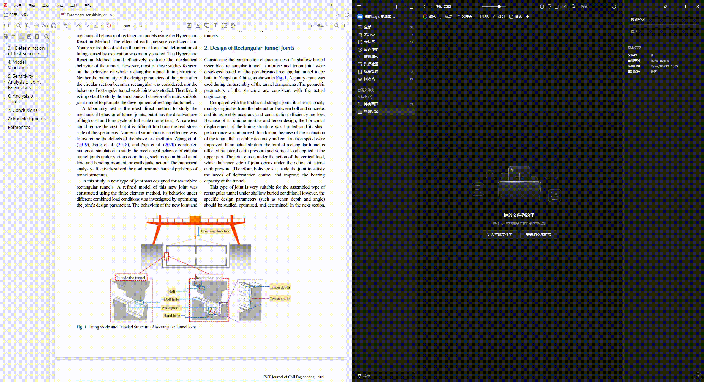
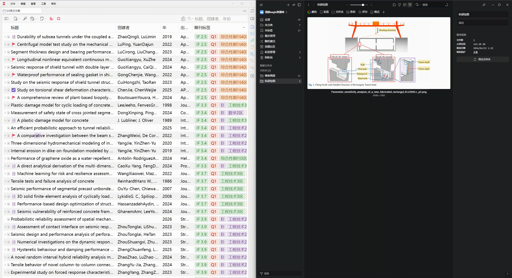
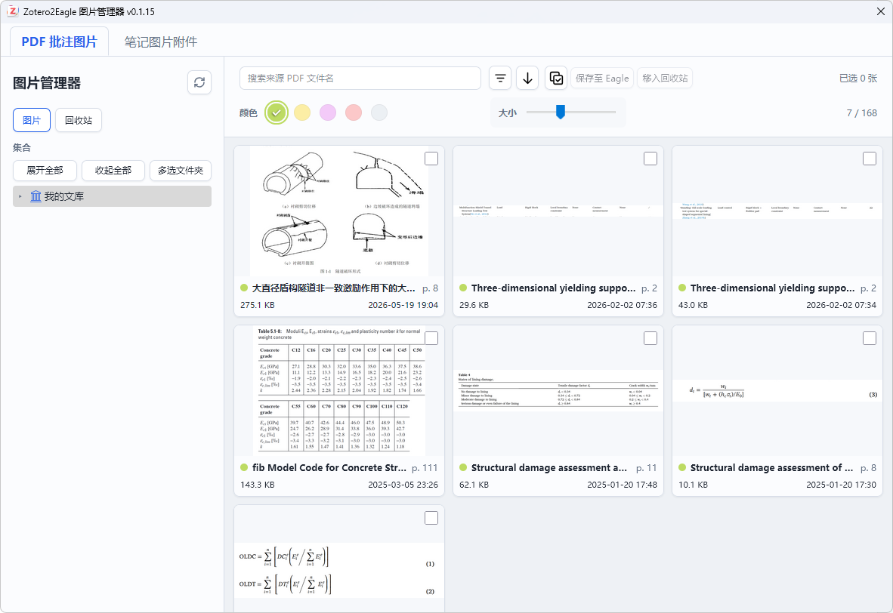
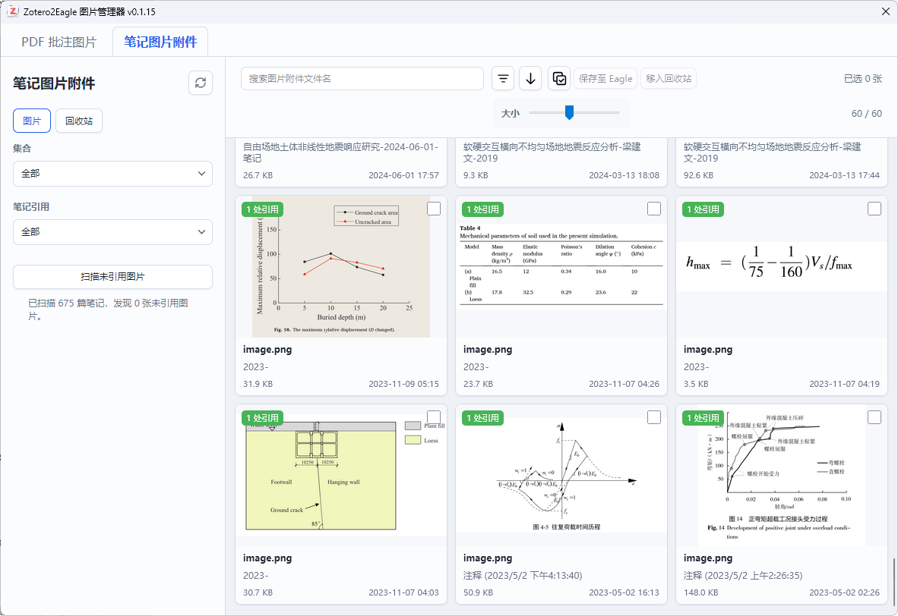

# Zotero2Eagle

<p align="center">
  
</p>

[](https://www.zotero.org) [](https://github.com/windingwind/zotero-plugin-template)

Zotero2Eagle is an image-focused plugin that imports PDF image annotations into Eagle and keeps a link back to the source PDF. It also integrates an Eagle-like image manager that works directly inside Zotero.

<!-- README-I18N:START -->

**English** | [简体中文](./doc/README-zhCN.md)

<!-- README-I18N:END -->

This project is built on [yueneiqi/zotero2eagle](https://github.com/yueneiqi/zotero2eagle). Thanks to the original author for their outstanding work.

The image manager is adapted from [heimi98/zotero-figure-overview](https://github.com/heimi98/zotero-figure-overview), which is licensed under AGPL-3.0-or-later. Because the original repository is no longer updated and does not support newer Zotero versions, it has been integrated into this repository. Thanks to the original author for their outstanding work.

## Features

- Import image annotations from Zotero PDFs into Eagle
- Write a `zotero://open-pdf/...` backlink into Eagle
- Save the title, authors, year, page number, attachment key, and annotation key
- Automatically import newly created image annotations
- Manually export selected image annotations from the PDF reader
- Browse image annotations in an image manager: filter by collection and color, preview images, and jump to the original annotation
- Check multiple images to save them to Eagle in a batch or move them to the manager trash
- Restore images from the manager trash, or permanently delete the Zotero image annotations after confirmation
- Manage image attachments embedded in notes separately, count note references automatically, and find unreferenced images

## Demo

### Auto Import

.gif>)

Create an image annotation in a Zotero PDF and it is imported into Eagle automatically.

### Manual Export



Select one or more image annotations, right-click, and export them to Eagle.

### Backlinks & Auto Tags



Every item imported into Eagle includes a `zotero://` backlink and auto-generated tags (title, authors, year, page number, etc.).

### Image Manager





An Eagle-like image manager. Image annotations created with the area selection tool are recognized and managed by the image manager automatically, and image attachments in notes can be managed as well.

## Installation

### Development Setup

1. Install dependencies in the project directory:

```bash
npm ci
```

2. Configure `.env`:

```env
ZOTERO_PLUGIN_ZOTERO_BIN_PATH=C:\\Program Files\\Zotero\\zotero.exe
ZOTERO_PLUGIN_PROFILE_PATH=C:\\Users\\YourName\\AppData\\Roaming\\Zotero\\Zotero\\Profiles\\YourDevProfile
```

3. Start development mode:

```bash
npm start
```

### Install the Build Output Manually

1. Build the plugin:

```bash
npm run build
```

2. The build writes `zotero-2-eagle.xpi` to `.scaffold/build/`. In Zotero 9 or 10, open `Tools -> Plugins` and choose `Install Plugin From File…` from the gear menu to install this file. You can also choose `Debug Plugins` from the gear menu, click `Load Temporary Add-on…`, and select `.scaffold/build/addon/manifest.json` to load the plugin as a temporary extension.

## Configuration

Open `Preferences -> Zotero2Eagle` and fill in:

- `Auto import`
- `Eagle API URL`
- `Eagle API Token`
- `Eagle Folder ID` (optional)

## Usage

### Auto Import

1. Check `Auto import`
2. Open a PDF in Zotero
3. Create an image annotation
4. The plugin waits for the cached image to be generated and imports it into Eagle

### Manual Export

In the PDF reader:

- Select one or more image annotations
- Right-click
- Click `Export Selected Image Annotations to Eagle`

### Image Manager

Click the image icon in Zotero's top tab bar to open the manager. Filter by collection and color, resize thumbnails, and double-click an image to jump to Zotero Reader. Right-click a single image to save it to Eagle or move it to the trash; use the checkboxes and the toolbar to act on all visible images in a batch.

The manager trash is kept across restarts. Moving an image to the trash only hides it in the manager, and the original Zotero annotation still exists. In the trash you can restore images, or, after confirmation, permanently delete the selected annotations or empty the trash. Permanent deletion removes only the Zotero image annotation and its local cache; notes, image attachments embedded in notes, and the source PDF are all kept. Saving an image to Eagle again follows the existing manual export behavior and may create a new item.

The manager also has a **Note image attachments** tab that collects images embedded in Zotero notes. Search by image attachment filename and filter by Zotero collection, preview images in the manager, open the source note, or save attachment files to Eagle. When the tab opens, image elements in notes are checked automatically and their references are counted. The result is kept in a reference index in the Zotero data directory (`zotero2eagle/note-references.json`), so later openings, including after restarting Zotero, only reread notes modified since the last check. **Scan unreferenced images** rereads every note. Images that could not be checked are marked **Unchecked**. Note images have their own trash; references are checked again before permanent deletion, and only attachments confirmed as unreferenced are deleted. Checking references never deletes images.

## Verification

Verify in a separate development profile.

1. Make sure Eagle is running and `Test Connection` in the plugin settings succeeds
2. Open an item that has a PDF
3. Create an image annotation
4. Check that a new image item appears in Eagle
5. Check that the Eagle item includes:
   - the `website` backlink
   - annotation text with the title, authors, year, page number, etc.
   - the expected tags
6. Click `website` in Eagle and confirm that it jumps back to the Zotero PDF

Notes:

- This project calls Eagle's local HTTP API from Zotero
- The destination folder field of the local HTTP API is `folderId`
- The corresponding concept in the Eagle Plugin API is `folders`; do not mix them up

## Testing

Unit tests run in Node and do not need Zotero:

```bash
npm run test:unit
```

Integration tests start Zotero with a separate profile and data directory (configure `.env` as described in Development Setup first) and exit after one run:

```bash
npm test -- --no-watch
```

Current test coverage:

- Zotero backlinks and Eagle export content (tags, annotation text, file names, `folderId`)
- Plugin instance, toolbar button, and image manager window structure
- Loading, filtering, sorting, and Reader navigation for image annotations and note images
- Manager trash, multi-selection, and permanent deletion
- Note reference counting and incremental updates of the reference index

## Release

- Current version: `v0.2.1`
- Release notes: [GitHub Releases](https://github.com/LuckYang1/zotero2eagle/releases)

## Contributing

1. Fork this repository
2. Create a feature branch
3. Make your changes following the coding guidelines in [DEVELOPMENT.md](doc/DEVELOPMENT.md)
4. Add tests for new features
5. Submit a pull request

## License

This project is licensed under the AGPL License - see the [LICENSE](LICENSE) file for details.

## Acknowledgments

Built with the [Zotero Plugin Template](https://github.com/windingwind/zotero-plugin-template) by [@windingwind](https://github.com/windingwind).

[](https://github.com/windingwind/zotero-plugin-template)
